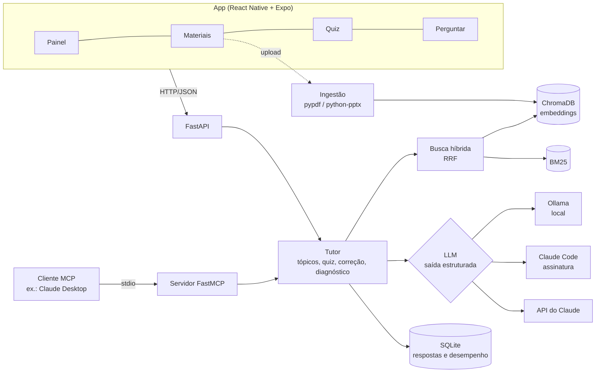
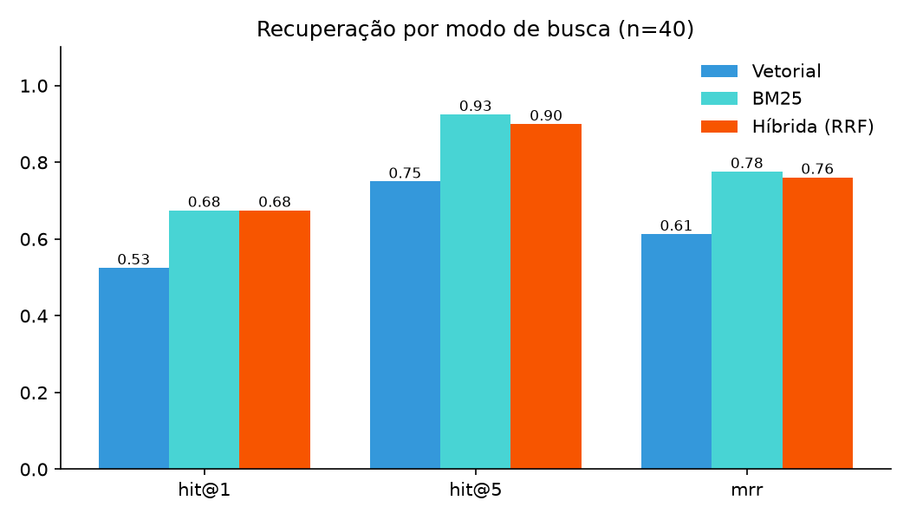
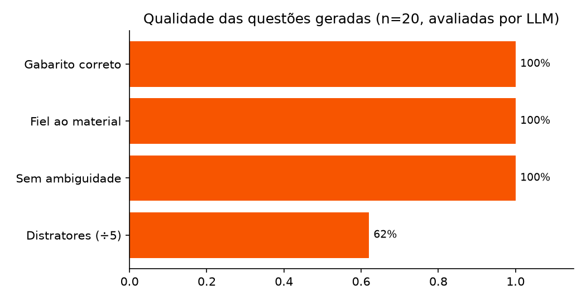

# Revisa AI: tutor de estudos com RAG

Trabalho 2 de Inteligência Artificial II (AMF, 2026/02). **Modalidade 3: integração com IA em contexto avançado** (RAG, API de LLM e servidor MCP).

O aluno envia os slides e PDFs de uma disciplina. O Revisa AI gera quizzes de múltipla escolha **a partir desse material**, corrige, explica cada erro citando a página de origem, descobre os tópicos em que o aluno está mais fraco e direciona os próximos quizzes para eles.

---

## 1. O problema

Na semana de prova, o aluno tem dezenas de PDFs e slides e não sabe o que já domina.

- Reler tudo é lento e passivo, e a técnica de estudo mais eficaz é a **prática de recuperação** (testar-se).
- Montar perguntas à mão toma horas, e as que existem na internet não seguem o material do professor.
- Chatbots genéricos respondem com conhecimento de fora da disciplina e às vezes inventam.

## 2. A solução

| Etapa | O que acontece | Técnica de IA |
|---|---|---|
| Envio do material | PDF, PPTX, TXT ou MD é dividido em trechos com página de origem | Chunking com sobreposição |
| Indexação | Cada trecho vira um vetor e também entra num índice lexical | Embeddings multilíngues + BM25 |
| Tópicos | A IA lê uma amostra do material e lista de 4 a 12 tópicos | LLM com saída estruturada |
| Quiz | Para cada tópico escolhido, busca os trechos mais relevantes e gera questões só com eles | **RAG** com busca híbrida (RRF) |
| Correção | Mostra a alternativa certa, a explicação e o trecho-fonte | Citação da fonte |
| Diagnóstico | Calcula o domínio por tópico e prioriza os mais fracos no modo adaptativo | Suavização de Laplace |
| Perguntar | Responde dúvidas livres só com o material, citando [1], [2]... | RAG |
| MCP | As mesmas funções ficam disponíveis para qualquer agente via MCP | FastMCP |

**Valor gerado:** estudo ativo em minutos, fiel ao conteúdo do professor, com feedback imediato e foco no que o aluno mais precisa.

## 3. Arquitetura



### Detalhes técnicos

- **Embeddings:** `paraphrase-multilingual-MiniLM-L12-v2` rodando localmente via ONNX (`fastembed`), sem GPU. Bom para português.
- **Busca híbrida:** a busca vetorial entende paráfrases; o BM25 acerta termos exatos ("ReLU", "LSTM", siglas). Os dois rankings são combinados por **Reciprocal Rank Fusion**: `score = Σ 1 / (60 + posição)`.
- **LLM com três provedores**, escolhidos na tela **Configurações** do app:

  | Provedor | Como funciona | Custo |
  |---|---|---|
  | **Ollama** (padrão) | Modelo aberto (ex.: `qwen2.5:3b`) rodando no próprio computador, via API local do Ollama | Grátis, offline |
  | **Claude Code** | O backend executa `claude -p --output-format json --json-schema ...`, que usa o login da assinatura do Claude no computador | Limite da assinatura (uso pessoal) |
  | **API do Claude** | SDK oficial (`claude-opus-5-5`) com `ANTHROPIC_API_KEY` | Por uso |

  Nos três casos a saída é **estruturada**: o backend envia o JSON Schema gerado pelo Pydantic e valida a resposta com o mesmo modelo. Se um modelo local errar o formato, o sistema tenta mais uma vez. O resto do sistema não sabe qual provedor respondeu.
- **Controles contra alucinação:**
  - o prompt proíbe conhecimento externo;
  - cada questão informa os IDs dos trechos usados, e IDs inventados são descartados;
  - questões malformadas (sem 4 alternativas ou com gabarito inválido) são descartadas;
  - as alternativas são **embaralhadas no servidor**, porque LLMs tendem a pôr a correta sempre na mesma letra;
  - o gabarito só é enviado ao app depois da resposta.
- **Modo adaptativo:** o domínio de cada tópico é `(acertos + 1) / (respondidas + 2)`. Um tópico nunca respondido fica em 50%, e um único erro não zera o tópico. O quiz adaptativo usa os 3 tópicos de menor domínio.

## 4. Estrutura do repositório

```
backend/
  app/
    config.py      configurações (.env)
    ingest.py      extração de texto (PDF/PPTX/TXT) e divisão em trechos
    store.py       ChromaDB + BM25 + fusão RRF
    llm.py         cliente do Claude com saída estruturada
    tutor.py       tópicos, quiz, correção, diagnóstico, perguntas
    db.py          SQLite
    main.py        API FastAPI
  mcp_server.py    servidor MCP (FastMCP)
  eval/run_eval.py avaliação de recuperação e de qualidade das questões
  tests/test_flow.py teste de ponta a ponta (LLM simulado, roda offline)
frontend/          app React Native (Expo Router), roda em Android, iOS e web
  src/app/         telas: Painel, Materiais, Quiz, Perguntar
  src/components/  shell, componentes visuais, painel lateral
  src/lib/         tema, cliente da API, estado global
sample_data/       material de exemplo (redes neurais)
docs/              prints e gráficos para o README
```

## 5. Como executar

Pré-requisitos: **Python 3.11+**, **Node 20+** e **um** dos provedores de IA abaixo.

### Provedor de IA (escolha um)

- **Ollama (recomendado, grátis):** instale em [ollama.com](https://ollama.com), deixe o aplicativo aberto e baixe o modelo:
  ```powershell
  ollama pull qwen2.5:3b
  ```
  Com 4 GB de GPU, o `qwen2.5:3b` cabe inteiro na placa. O `qwen2.5:7b` gera questões melhores, porém mais devagar.
- **Claude Code (assinatura):** com o Claude Code instalado, rode `claude auth login` uma vez. O executável é detectado sozinho, inclusive o que vem junto com o app desktop do Claude.
- **API do Claude:** coloque a `ANTHROPIC_API_KEY` em `backend/.env`.

Depois, no app, abra **Configurações**, escolha o provedor e clique em **Testar conexão**.

### Backend

```powershell
cd backend
py -3.11 -m venv .venv
.venv\Scripts\Activate.ps1
pip install -r requirements.txt
copy .env.example .env      # só precisa editar se for usar a API do Claude
uvicorn app.main:app --port 8000
```

A documentação interativa da API fica em http://localhost:8000/docs. Na primeira execução, o modelo de embeddings (~120 MB) é baixado automaticamente.

### Frontend

```powershell
cd frontend
npm install
npx expo start --web        # abre no navegador
```

- **Celular:** rode `npx expo start`, abra o app **Expo Go** e leia o QR code. Crie `frontend/.env` com `EXPO_PUBLIC_API_URL=http://<IP-da-sua-máquina>:8000` e suba o backend com `--host 0.0.0.0`.
- **Emulador Android:** já usa `http://10.0.2.2:8000` por padrão.

### Servidor MCP (opcional)

```powershell
cd backend
.venv\Scripts\python mcp_server.py
```

Ferramentas expostas: `listar_disciplinas`, `listar_topicos`, `buscar_no_material`, `gerar_quiz`, `desempenho_do_aluno` e `perguntar_ao_material`. Exemplo de configuração no Claude Desktop (`claude_desktop_config.json`):

```json
{
  "mcpServers": {
    "revisa-ai": {
      "command": "C:\\caminho\\g2-ia\\backend\\.venv\\Scripts\\python.exe",
      "args": ["C:\\caminho\\g2-ia\\backend\\mcp_server.py"]
    }
  }
}
```

### Passo a passo de uso

1. Em **Materiais**, crie a disciplina e envie os PDFs ou slides. Para testar, use `sample_data/redes_neurais.md`.
2. Em **Quiz**, escolha o modo **Misto** e gere o primeiro quiz.
3. Responda, veja as explicações e abra os trechos-fonte.
4. O **Painel** mostra o domínio por tópico e os pontos fracos; **Treinar pontos fracos** gera um quiz adaptativo.
5. Em **Perguntar**, tire dúvidas livres com citação das páginas.

## 6. Avaliação

### Teste automatizado (offline)

```powershell
cd backend
.venv\Scripts\python -m tests.test_flow
```

Verifica ingestão, busca híbrida, descarte de questões inválidas, embaralhamento do gabarito, filtro de fontes inventadas, correção, cálculo de pontos fracos e prioridade do modo adaptativo. O LLM é simulado, então o teste não gasta créditos.

### Métricas (exigem um provedor de IA configurado e um material enviado)

As métricas usam o provedor escolhido nas Configurações. Vale rodar com o Ollama e com o Claude e comparar a qualidade das questões no README.

```powershell
cd backend
.venv\Scripts\python -m eval.run_eval retrieval --course 1 --samples 40
.venv\Scripts\python -m eval.run_eval quiz --course 1 --quizzes 4 --per-quiz 5
```

1. **Recuperação (vetorial × BM25 × híbrida):** para cada trecho sorteado, o LLM escreve uma pergunta que só aquele trecho responde. Medimos **Hit@1**, **Hit@5** e **MRR** em cada modo de busca. O resultado vai para `eval/results/retrieval.png`.
2. **Qualidade das questões (LLM-as-judge):** um avaliador com critérios fixos verifica se o gabarito está correto, se a questão é fiel ao material, se não é ambígua e se os distratores são plausíveis. O resultado vai para `eval/results/quiz_quality.png`, e o `quiz_review.csv` serve para a revisão humana do grupo.

Troque `--course 1` pelo id da disciplina avaliada.

### Resultados

Avaliação feita em 21/11/2026 com o material real de IA II (12 PDFs, 558 trechos), usando o Claude Sonnet via Claude Code. Os arquivos brutos estão em `backend/eval/results/`.

**Recuperação (40 perguntas, top 5)**

| Modo de busca | Hit@1 | Hit@5 | MRR |
|---|---|---|---|
| Vetorial | 52,5% | 75,0% | 0,613 |
| BM25 | 67,5% | 92,5% | 0,776 |
| Híbrida (RRF) | 67,5% | 90,0% | 0,761 |



- A busca só vetorial ficou claramente atrás neste material.
- BM25 e híbrida ficaram praticamente empatados: a diferença no Hit@5 é de uma pergunta em 40, pequena demais para apontar um vencedor.
- **Limitação:** as perguntas foram escritas pelo LLM a partir dos próprios trechos, o que tende a repetir palavras do texto e favorecer o BM25. Perguntas reais de alunos podem mudar esse resultado.

**Qualidade das questões (20 questões, 4 quizzes)**

| Critério | Resultado |
|---|---|
| Gabarito correto | 20 de 20 |
| Fiel ao material | 20 de 20 |
| Sem ambiguidade | 20 de 20 |
| Plausibilidade dos distratores | 3,1 de 5 |



- O ponto mais fraco são os distratores: as alternativas erradas ainda podem ficar mais convincentes.
- **Limitação:** o mesmo modelo gerou e avaliou as questões, então os 100% são uma verificação automática otimista, não uma prova de qualidade. A amostra também é pequena. A coluna `revisao_humana_ok` de `quiz_review.csv` existe para a conferência manual do grupo.
- Estes números valem para o Claude Sonnet. O modelo local `qwen2.5:3b` não foi medido por este script; em um teste informal, ele gerou questões ambíguas e com tópico errado.

## 7. Impacto e próximos passos

- **Uso real:** qualquer disciplina, qualquer aluno. O professor também pode usar para montar listas de exercícios a partir do próprio material.
- **Escalabilidade:** trocar SQLite por PostgreSQL e ChromaDB local por um servidor vetorial; adicionar login por aluno.
- **Melhorias:**
  - repetição espaçada (revisar o tópico no dia certo);
  - OCR para PDFs escaneados;
  - questões discursivas corrigidas por IA;
  - turma compartilhada, em que o professor vê os tópicos mais errados pela turma toda.
